Diseño, construyo y opero **sistemas de IA en producción** que usan personas reales todos los días, y los protejo con una seguridad pensada desde el diseño.

> **Mi regla:** medir antes de construir, atacar lo propio antes de entregarlo y no decir "hecho" sin verificarlo en vivo.

---

## 🤖 IA aplicada

- **Agentes conversacionales que no inventan.** Un LLM redacta la respuesta y una capa determinista rechaza cualquier cifra o compromiso que no esté respaldado por una fuente. Antes de rediseñar, mido cientos de conversaciones reales; después, valido re-jugando conversaciones reales con el modelo real.
- **Agentes de punta a punta:** de una reunión grabada a la transcripción, el acta, el plan y los entregables. Un revisor con rúbrica obliga a reescribir lo incoherente.
- **Ruteo por costo de error:** cada tarea va al modelo que corresponde según lo que cuesta equivocarse, no según lo que suena mejor.
- **Modelos de decisión medidos:** asignación por probabilidad estimada a partir de datos históricos, en lugar de reglas fijas.
- **Visión y documentos:** OCR propio, extracción de datos desde planos técnicos y generación de documentos con revisión humana.
- **Aprendizaje adaptativo**, con un humano en el circuito para las decisiones que ninguna máquina debe tomar sola.

## 📊 Datos y estadística

- Pruebas A/B que **no coronan ganadores falsos**: prueba de dos proporciones con corrección por comparaciones múltiples y cálculo de cuánta muestra falta.
- Antes de proponer, separo lo **replicable** de la **referencia inalcanzable**: un patrón que rinde 43× más no sirve si viene de cuentas cien veces más grandes.
- **Re-derivar cada cifra:** cuando dos números de la misma cosa no coinciden, se está midiendo otra columna.

## 🛡️ Seguridad

- **Pentesting ofensivo con IA** sobre activos propios: OWASP Top 10, control de acceso, IDOR, SSRF e inyección. Cada hallazgo se prueba con una prueba de concepto real, sin falsos positivos.
- **Seguridad por diseño:** mínimo privilegio, cifrado recuperable en tránsito y en reposo, custodia separada de llaves y respaldos que solo cuentan si su restauración está probada.
- **Respuesta a vulnerabilidades:** parcheo coordinado y verificación por comportamiento de lo que realmente corre, no por el mensaje de "deploy exitoso".
- **DevSecOps:** escaneo en el pipeline e inspección de lo que se *sirve* al navegador, no solo del código fuente.
- **Gobierno:** controles basados en ISO/IEC 27001 y SOC 2.

<b>🧪 Un caso: la sesión que fallaba 1 de cada 223 veces</b>
 

Algunos usuarios iniciaban sesión y el sistema les decía que no estaban autenticados. Al reintentar funcionaba, así que a mano era imposible de reproducir. La causa: una firma HMAC en bytes crudos se separaba del mensaje buscando un delimitador, y ese delimitador podía aparecer dentro de la propia firma. Lo medí (0,45 % de 300.000 firmas), lo corregí separando por longitud sin cambiar el formato en el cable, para que nadie perdiera su sesión al desplegar, y dejé una prueba que **busca** el caso en lugar de depender del azar.

---

## 🛠️ Herramientas

🔒 Mi trabajo profesional es privado porque procesa datos reales de terceros. Puedo hacer demos en vivo.
